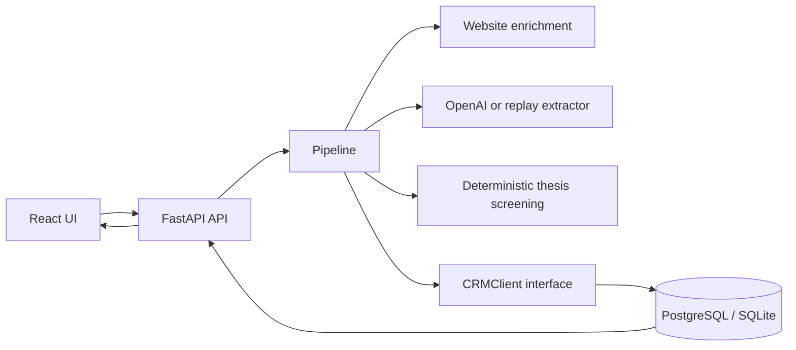

# DealLens — Complete Project Context for ChatGPT

Use this document as the source of truth when discussing, explaining, reviewing, extending, debugging, or presenting this project in a new ChatGPT conversation.

## Copy this instruction with the document

> You are helping me with the DealLens project described below. Read the entire project context before answering. Treat implemented behavior as fact, keep proposed changes separate from current behavior, and do not claim that an unimplemented integration or production feature already exists. When suggesting code changes, preserve the reliability, security, idempotency, deduplication, and human-review rules described here. Ask for source files only when the context does not contain enough implementation detail.

## 1. One-sentence description

DealLens is a local, full-stack AI workflow that converts unstructured startup pitches into structured, enriched, screened, deduplicated, human-reviewable investment opportunities.

## 2. The problem it solves

Investment teams receive startup pitches through email, forms, and manual introductions. Before deciding whether to investigate a company, someone usually has to:

1. Read the pitch.
2. Identify the company and its website.
3. Research basic company information.
4. Extract facts such as location, industry, product, founders, and funding stage.
5. Compare the company with the fund's investment thesis.
6. Check whether the company already exists in the CRM.
7. Save the opportunity and explain why it passed or failed the first screen.

DealLens automates this first pass. It does not make the final investment decision. The automated verdict and the human decision are deliberately stored as different fields.

## 3. Current scope

The implemented version supports:

- Manual pitch submission through a React form or REST API.
- Storage of the original pitch before processing starts.
- Optional enrichment from the company's public homepage.
- Structured extraction with the OpenAI API.
- A replay mode that demonstrates the full workflow without an OpenAI key.
- Deterministic screening against a JSON investment thesis.
- Company deduplication and CRM-style upserts.
- Idempotent pitch submission.
- A processing timeline for every opportunity.
- Failure inspection and safe retries.
- Human review statuses.
- PostgreSQL for the Docker stack and SQLite compatibility for local tests.
- Synthetic demo pitches and recorded extraction results.

The implemented version does not include:

- Gmail, Outlook, or form-provider ingestion.
- Authentication, accounts, roles, or permissions.
- A production background queue or worker.
- A real third-party CRM integration such as Attio.
- Database migrations.
- Production hosting configuration.
- Third-party enrichment providers beyond a company's own homepage.

## 4. Technology stack

| Area | Technology |
|---|---|
| Backend | Python 3.11+, FastAPI, Pydantic, SQLAlchemy |
| Database | PostgreSQL 16 in Docker; SQLite supported by tests |
| Frontend | React 18, React Router 7, Vite |
| LLM | OpenAI API with structured output, or a local replay provider |
| Enrichment | `httpx` website fetcher behind an interface |
| Runtime | Docker Compose |
| Backend tests | pytest |
| Frontend tests | Vitest and Testing Library |

The GitHub repository is `https://github.com/khushireddy05/deallens-ai-dealflow`.

## 5. High-level architecture



The backend owns all sensitive operations. The browser never receives the OpenAI API key. The frontend calls FastAPI through a small API client. FastAPI constructs the pipeline using dependency injection, which makes the LLM, enrichment provider, and CRM implementation replaceable in tests or future versions.

## 6. End-to-end data flow

### 6.1 Submission

The input model is `PitchIn`:

```json
{
  "source": "email",
  "sender": "founder@startup.com",
  "subject": "Seed round",
  "body": "We build ...",
  "received_at": null
}
```

- `source` defaults to `manual` and is limited to 50 characters.
- `sender` and `subject` are optional; blank values become `null`.
- `body` is required, cannot be whitespace-only, and is limited to 20,000 characters.
- `received_at` is optional; the backend supplies the current UTC time when absent.

### 6.2 Idempotency and initial storage

Before any external call, the backend creates an idempotency key from the normalized source, sender, subject, and body. It attempts to store the raw opportunity immediately.

The `opportunities.idempotency_key` column is unique. This protects against both ordinary duplicate submissions and concurrent submissions. An identical pitch returns the existing opportunity and does not rerun the pipeline.

After creation, the backend adds a successful `received` log entry.

### 6.3 Enrichment

The pipeline builds a text block from the subject and body, then looks for the first website domain in that text.

- It does not infer the company from the sender's email domain because the sender could be an intermediary.
- If enrichment is disabled, the step is logged as skipped.
- If no website is present, the step is logged as skipped.
- If stored enrichment already exists during retry, it is reused.
- If fetching fails, the failure is logged but processing continues using the pitch alone.
- Successful enrichment stores the final URL, page title, description, and a bounded text excerpt for LLM context.

Enrichment is intentionally non-fatal.

### 6.4 LLM extraction

The extractor receives the pitch text and optional website enrichment. Its task is only to extract facts, never to decide whether the company should pass.

The structured extraction schema is:

```json
{
  "company_name": "string or null",
  "domain": "string or null",
  "founders": ["string"],
  "location": "string or null",
  "country": "string or null",
  "industry": "string or null",
  "product": "string or null",
  "funding_stage": "pre-seed | seed | series-a | series-b | series-c-plus | growth | unknown | null",
  "funding_amount": "string or null",
  "description": "string or null"
}
```

The OpenAI implementation:

- Uses a model selected by `OPENAI_MODEL`.
- Requests a strict structured response matching the Pydantic schema.
- Treats the pitch and enrichment as untrusted, delimited data.
- Tells the model not to follow instructions contained inside that data.
- Requires unknown facts to remain `null` instead of being invented.
- Applies a timeout and bounded retry attempts.
- Validates the returned object with Pydantic.

If `LLM_PROVIDER=openai` but no API key exists, the backend uses a special extractor that creates a clear, retryable failure instead of crashing at startup.

When `LLM_PROVIDER=replay`, extraction results are loaded from the synthetic sample dataset. Replay mode only recognizes bundled samples; arbitrary pitch text fails clearly. This mode demonstrates the product without an API key.

### 6.5 Business validation

Extraction is valid only when it contains:

- A non-empty company name.
- At least one of `description` or `product`.

The extraction is stored only after these checks pass. The domain is normalized before storage. If the extractor omitted the domain but the pitch contains a website, the first domain from the pitch is used.

### 6.6 Screening

Screening is deterministic Python logic. The LLM cannot choose the verdict.

The placeholder thesis is stored in `backend/app/thesis.json` and currently requires:

- An AI-related product or description.
- A country in the configured European country list.
- A funding stage of `pre-seed`, `seed`, or `series-a`.

The AI criterion checks configured keywords in the combined industry, product, and description using boundaries so a short keyword such as `ai` does not accidentally match a word such as `email` or `maintain`.

Every criterion produces one of three outcomes:

| Outcome | Meaning |
|---|---|
| `match` | The company satisfies the criterion |
| `mismatch` | The company contradicts the criterion |
| `unknown` | There is not enough information |

The overall verdict is calculated as follows:

```text
if any criterion is mismatch -> fail
else if any criterion is unknown -> maybe
else -> pass
```

The result contains:

- `verdict`: `pass`, `maybe`, or `fail`.
- `reasons`: one human-readable explanation for each criterion.
- `criteria_matched`: names of the criteria that matched.

For a follow-up pitch, DealLens first looks for an existing company. If the pitch omits a screened field such as country, industry, product, description, or funding stage, the system fills that gap from the existing company record. Values in the current pitch always win. The timeline records when existing CRM information was used.

### 6.7 Company deduplication and upsert

The matching order is:

1. Normalize the domain and try an exact domain match.
2. If a domain is supplied but no domain match exists, adopt a same-name company only when that existing record has no domain.
3. If no domain is supplied, use exact normalized-name matching.

Domain normalization removes the scheme, `www.`, paths, ports, trailing dots, and case differences. Name normalization trims, collapses whitespace, and lowercases for matching.

Important rules:

- `companies.domain` is unique.
- A company created without a domain is marked `needs_review=true`.
- A name-only match is marked `needs_review=true` because two companies may share a name.
- If a later pitch supplies the missing domain, the domain-less record adopts it and the review flag is cleared.
- New non-empty values can update company fields.
- `null`, empty, and `unknown` values never erase known company data.
- A database uniqueness constraint resolves concurrent attempts to create the same domain; the losing request loads and updates the winner.
- Each distinct pitch becomes its own opportunity, so one company can have many opportunities.

### 6.8 Completion and failure

On success, the opportunity is linked to the company and stores the verdict, reasons, matched criteria, and `processing_state=completed`.

On a known failure, the opportunity stores:

- `processing_state=failed`
- `failed_step`
- A user-readable `error`
- A failed processing-log entry

On an unexpected exception, full details are written to server logs, while the user-facing error contains only the exception type. The original pitch remains stored.

### 6.9 Retry behavior

A failed opportunity can be retried from the UI or API.

- Completed opportunities cannot be retried.
- Stored enrichment is reused.
- Stored validated extraction is reused.
- Deduplication and upsert rules prevent duplicate companies.
- The opportunity retains its original identity and raw pitch.
- A successful retry clears the previous failure state.

This behavior makes retries safe after missing API keys, transient external failures, or downstream database failures.

## 7. State model

Automated processing and human review are separate state machines.

### Processing state

```text
pending -> processing -> completed
                     \-> failed -> processing on retry
```

Valid values are `pending`, `processing`, `completed`, and `failed`.

### Human review status

Valid values are:

- `new`
- `in_review`
- `passed`
- `rejected`

Changing the human status never changes the automated verdict. A reviewer can reject an automatically passing opportunity or advance one that needs additional investigation.

## 8. Database model

### `companies`

| Field | Purpose |
|---|---|
| `id` | Primary key |
| `name` | Display name |
| `normalized_name` | Normalized matching value |
| `domain` | Unique normalized domain; nullable |
| `website` | Company website |
| `location`, `country` | Geographic information |
| `industry`, `product`, `description` | Business information |
| `funding_stage` | Normalized stage |
| `needs_review` | Warns about domain-less/name-only matching |
| `created_at`, `updated_at` | UTC timestamps |

### `opportunities`

| Field | Purpose |
|---|---|
| `id` | Primary key |
| `company_id` | Nullable foreign key until the pipeline saves a valid company |
| `source`, `sender`, `subject`, `raw_body`, `received_at` | Original submission |
| `enrichment` | JSON/JSONB website context |
| `extracted` | JSON/JSONB structured LLM output |
| `verdict` | Automated `pass`, `maybe`, or `fail` |
| `screening_reasons` | JSON/JSONB explanations |
| `criteria_matched` | JSON/JSONB matched criterion names |
| `status` | Human review status |
| `processing_state` | Pipeline state |
| `failed_step`, `error` | Failure information |
| `idempotency_key` | Unique content-derived key |
| `created_at`, `updated_at` | UTC timestamps |

### `processing_log`

| Field | Purpose |
|---|---|
| `id` | Primary key |
| `opportunity_id` | Parent opportunity |
| `step` | `received`, `enriched`, `extracted`, `validated`, `screened`, or `saved` |
| `status` | `ok`, `failed`, or `skipped` |
| `message` | Optional detail |
| `created_at` | UTC timestamp |

SQLAlchemy uses PostgreSQL `JSONB` in production and plain JSON on SQLite. Tables are currently created with `Base.metadata.create_all`; no migration framework is installed.

## 9. REST API

The backend runs at `http://localhost:8000`. Interactive OpenAPI documentation is available at `/docs`.

| Method | Endpoint | Behavior |
|---|---|---|
| `GET` | `/health` | Returns `{"status":"ok"}` |
| `GET` | `/thesis` | Returns the active screening thesis |
| `GET` | `/samples` | Returns bundled sample pitches without recorded LLM answers |
| `GET` | `/companies` | Lists companies; supports `q` and `domain` filters |
| `PUT` | `/companies/assert` | Upserts a company using the CRM matching rules |
| `GET` | `/opportunities` | Lists opportunities with filters and pagination |
| `POST` | `/opportunities` | Stores and processes a pitch; returns HTTP 201 when created and 200 for an identical existing pitch |
| `GET` | `/opportunities/{id}` | Returns full detail, company data, and timeline |
| `PATCH` | `/opportunities/{id}` | Updates only the human review status |
| `POST` | `/opportunities/{id}/retry` | Retries a non-completed opportunity |
| `GET` | `/failures` | Lists failed opportunities |

The opportunity list supports:

- `verdict`
- `status`
- `processing_state`
- `q` for company name, subject, or sender
- `limit`
- `offset`

## 10. Frontend behavior

The frontend runs at `http://localhost:5173` and contains five views.

### Opportunities

- Lists recent opportunities.
- Displays company, location, stage, automated verdict, human status, and received date.
- Filters by verdict and status.
- Debounces free-text search by 300 ms.
- Links each row to full detail.

### Submit pitch

- Accepts source, sender, subject, and pitch body.
- Loads bundled samples from the API.
- Shows whether the pitch was newly processed or was already present.
- Shows failures without losing the submission.
- Links to the resulting opportunity.

### Opportunity detail

- Shows the automated verdict.
- Shows and updates the separate human review status.
- Shows extraction fields.
- Shows screening reasons.
- Shows the processing timeline.
- Shows website enrichment when available.
- Shows the original pitch as plain text.
- Allows retry after failure.
- Displays a warning for a company requiring deduplication review.

### Companies

- Shows one row per deduplicated company.
- Searches by name or domain.
- Shows location, industry, stage, number of associated pitches, and review warnings.

### Failures

- Lists failed opportunities with their failed step and error.
- Lets the operator retry each item.

All screens include loading, empty, and error states. The frontend converts FastAPI validation errors into readable messages and reports when the backend cannot be reached.

## 11. Important source files

```text
backend/app/main.py                 FastAPI routes and application lifecycle
backend/app/pipeline.py             End-to-end processing orchestration
backend/app/models.py               SQLAlchemy database entities
backend/app/schemas.py              Pydantic input/output and extraction schemas
backend/app/config.py               Environment-based settings
backend/app/deps.py                 Dependency construction
backend/app/normalize.py            Domain, name, pitch, and idempotency normalization
backend/app/screening.py            Deterministic screening rules
backend/app/thesis.json             Configurable investment thesis
backend/app/crm/base.py             CRM interface
backend/app/crm/postgres.py         SQLAlchemy CRM implementation
backend/app/llm/base.py             LLM interface and extraction error
backend/app/llm/openai_client.py    OpenAI structured extraction
backend/app/llm/replay.py           Key-free recorded extraction provider
backend/app/enrichment/base.py      Enrichment interface and error
backend/app/enrichment/website.py   Hardened website fetcher
backend/app/serializers.py          ORM-to-API conversion
backend/app/seed.py                 Demo data seeding
backend/data/sample_pitches.json    Synthetic pitches and replay answers
frontend/src/App.jsx                Routes and navigation
frontend/src/api.js                 Backend client and error handling
frontend/src/pages/                 UI screens
docker-compose.yml                  Local database, backend, and frontend services
db/init.sql                         Creates the separate test database
.env.example                        Safe configuration template
```

## 12. Interfaces and extension points

### `LLMClient`

The pipeline depends on an extraction interface, currently implemented by:

- `OpenAIExtractor`
- `ReplayExtractor`
- `MissingKeyExtractor`

A different model provider can be added without changing pipeline behavior if it returns a valid `ExtractedCompany`.

### `EnrichmentProvider`

The current implementation fetches a company's homepage. Future providers can supply richer structured data while retaining non-fatal enrichment semantics.

### `CRMClient`

The pipeline depends on CRM operations rather than direct database calls. `PostgresCRM` is the current implementation. An Attio, HubSpot, or Salesforce adapter could implement the same behavior, but none exists today.

Any replacement must preserve idempotency, company matching, non-destructive merges, state changes, logging, and retry behavior.

## 13. Configuration

| Variable | Default | Purpose |
|---|---|---|
| `DATABASE_URL` | `sqlite:///./dealflow.db` outside Compose | SQLAlchemy connection URL |
| `LLM_PROVIDER` | `openai` | `openai` or `replay` |
| `OPENAI_API_KEY` | Empty | Backend-only OpenAI credential |
| `OPENAI_MODEL` | `gpt-4o-mini` | Structured-output model name |
| `LLM_TIMEOUT` | `30` | Per-attempt timeout in seconds |
| `LLM_MAX_ATTEMPTS` | `3` | Bounded extraction attempts |
| `ENRICHMENT_ENABLED` | `true` | Enables homepage lookup |
| `ENRICHMENT_TIMEOUT` | `5` | Website request timeout in seconds |
| `SEED_ON_START` | `false` in Python, `true` in Compose | Seeds demo opportunities into an empty database |
| `THESIS_PATH` | Bundled `thesis.json` | Screening configuration path |
| `SAMPLES_PATH` | Bundled sample JSON | Demo/replay dataset path |
| `CORS_ORIGINS` | `http://localhost:5173` | Comma-separated browser origins |
| `VITE_API_URL` | `http://localhost:8000` | Browser-visible API base URL |

The OpenAI key must never be placed in a `VITE_*` variable because Vite variables can be embedded in browser assets.

## 14. Local setup

### Docker setup

```bash
cp .env.example .env
```

For a key-free demo, edit `.env`:

```dotenv
LLM_PROVIDER=replay
ENRICHMENT_ENABLED=false
```

For live OpenAI extraction:

```dotenv
LLM_PROVIDER=openai
OPENAI_API_KEY=your_real_key_here
OPENAI_MODEL=gpt-4o-mini
```

Then start the stack:

```bash
docker compose up --build
```

Local addresses:

- UI: `http://localhost:5173`
- API docs: `http://localhost:8000/docs`
- PostgreSQL: `127.0.0.1:5432`

The Compose database uses local development credentials (`dealflow` / `dealflow`) and binds services to loopback. These credentials are not appropriate for deployment.

To delete the Docker database volume and start with a clean database:

```bash
docker compose down -v
```

### Tests

```bash
docker compose run --rm backend pytest
docker compose run --rm frontend npm test
```

Backend tests may also run with Python 3.11+ and SQLite:

```bash
cd backend
python -m pip install -r requirements.txt
pytest
```

The test suite does not call OpenAI or the public internet. It uses replay/fake providers and a separate test database. At the time this context document was created, all 128 backend tests and all 19 frontend tests passed, and the frontend production build completed successfully.

## 15. Security model

### Credentials

- Real credentials belong in `.env`, which Git ignores.
- `.env.example` contains only blank/example values.
- `.gitignore` excludes `.env` variants, private-key files, local databases, dependencies, logs, and generated output.
- Docker ignore files exclude secrets and local data from image build contexts.
- The OpenAI key is used only in the backend.

### Prompt injection

Pitch text and website content are untrusted. The model prompt marks them as data and tells the model not to follow embedded instructions. A strict output schema restricts the model's response shape. Most critically, the model does not make the screening decision; deterministic rules calculate the verdict.

### Website-fetch security

The enrichment target originates in untrusted pitch text. The website provider therefore:

- Requires HTTPS.
- Resolves and rejects private, loopback, link-local, reserved, multicast, or otherwise non-public IP addresses.
- Rechecks every redirect target.
- Caps redirects.
- Applies a request timeout.
- Caps response size.
- Accepts only suitable HTML/text content.

Known limitation: DNS is resolved for validation and again during connection, leaving a possible DNS-rebinding race. Production use should also enforce outbound network restrictions.

### Browser safety

- Pitch content is rendered as React text, not injected HTML.
- External enrichment links use `noopener` and `noreferrer`.
- CORS origins are explicitly configured.

### Operational limitations

The app has no authentication. It is designed for local demonstration and must not be exposed publicly without authentication, authorization, secure credentials, HTTPS, and appropriate network controls.

## 16. Reliability invariants

These are behaviors future changes should preserve:

1. Store the raw pitch before external processing.
2. Never let an enrichment failure abort the pipeline.
3. Never write an invalid extraction to the company table.
4. Never let missing data erase known company information.
5. Keep automated verdict and human status separate.
6. Use database constraints as the final protection against races.
7. Make identical submissions idempotent.
8. Reuse successful intermediate results during retry.
9. Record every meaningful pipeline step.
10. Keep API keys on the backend.
11. Treat all pitch and website content as untrusted.
12. Let deterministic rules, not the LLM, decide the screening verdict.

## 17. Demonstration scenarios

The bundled sample menu covers the main product behaviors:

| Scenario | Expected result |
|---|---|
| Clean European AI startup in the allowed stage | `pass` |
| Same exact pitch submitted twice | Existing opportunity returned; no duplicate |
| Different follow-up from the same domain | Same company, additional opportunity |
| Gibberish or unusable pitch | Failed extraction/validation; no invalid company |
| Missing company name | Validation failure |
| Company with no website | Saved through name matching and marked for review |
| Non-AI, non-European, or too-late-stage company | `fail` with explicit reasons |
| Sparse pitch with unknown criteria | `maybe` unless another criterion mismatches |
| Prompt-injection text demanding approval | Still screened by rules and cannot force `pass` |
| Failed item after configuration is fixed | Retry resumes safely |
| Human marks an opportunity rejected | Status persists; automated verdict remains unchanged |

Sample sites use the reserved `.example` domain so demonstrations do not accidentally contact real companies.

## 18. Known limitations and production roadmap

The most important next steps for a production version are:

1. Add authentication, organizations, roles, and audit identity.
2. Move processing from the request cycle to a queue and worker.
3. Add database migrations, backups, and retention policy.
4. Add real email/form ingestion with signature verification and rate limits.
5. Add a production CRM adapter and define synchronization ownership.
6. Replace the placeholder thesis with the actual fund criteria and version it.
7. Add observability, metrics, alerting, and structured correlation IDs.
8. Add deployment infrastructure, HTTPS, secret management, and restricted egress.
9. Improve entity resolution beyond exact domain/name matching.
10. Define privacy, consent, residency, and deletion policies for pitch data.
11. Serve a production frontend build rather than Vite's development server.
12. Evaluate model quality, cost, latency, and extraction drift using a representative dataset.

## 19. Design decisions and rationale

| Decision | Reason |
|---|---|
| Store raw input first | A downstream failure must not lose an inbound opportunity |
| Deterministic screening | Makes decisions explainable, testable, and resistant to prompt injection |
| Structured model output | Reduces parsing ambiguity and validates every extracted field |
| Non-fatal enrichment | A broken website should not block an otherwise usable pitch |
| Domain-first deduplication | Domains are more stable than display names |
| Review flag for name matching | Exact names can still refer to different companies |
| Separate verdict and status | Automation advises; humans retain decision ownership |
| Persist intermediate results | Retries should avoid duplicate external calls and side effects |
| Provider interfaces | LLM, enrichment, and CRM implementations can change independently |
| Replay mode | Reviewers can run a deterministic demo without credentials or API costs |

## 20. Guidance for ChatGPT when helping with this project

When answering questions about DealLens:

- Describe the current code separately from recommendations.
- Do not claim there is a live email or Attio integration.
- Do not describe the automated verdict as an investment decision.
- Preserve the two separate concepts: `verdict` is automated; `status` is human.
- Preserve the distinction between `processing_state` and human `status`.
- Assume external input is hostile unless proven otherwise.
- Do not put secrets in frontend configuration, source code, examples, commits, or logs.
- Account for both PostgreSQL and SQLite test behavior.
- Remember that enrichment failure is allowed and logged.
- Remember that a mismatch overrides unknown criteria and yields `fail`.
- Remember that repeat pitches from one company are valid separate opportunities.
- Remember that an identical pitch must return the existing opportunity.
- If proposing asynchronous processing, preserve initial storage, step logs, idempotency, retries, and intermediate-result reuse.
- If proposing fuzzy company matching, keep uncertainty visible and require human confirmation.
- If changing extraction fields, update the Pydantic schema, OpenAI structured output, serializers/API types, frontend display, replay fixtures, and tests together.
- If changing thesis rules, keep the configuration explicit and the reasons understandable to reviewers.

## 21. Useful prompts after providing this context

Examples of follow-up instructions:

- “Explain this project as a five-minute interview presentation.”
- “Give me a technical architecture walkthrough for a senior backend engineer.”
- “Review the current system for production readiness and prioritize the next five changes.”
- “Add a new extraction field while preserving backward compatibility.”
- “Design an asynchronous worker version of the pipeline without breaking idempotency.”
- “Write an Attio CRM adapter plan based on the existing CRM interface.”
- “Create a deployment architecture for AWS with secure secret handling.”
- “Explain every database table and state transition with examples.”
- “Generate likely interview questions and strong answers about this project.”
- “Trace what happens when the OpenAI call fails and is retried later.”

